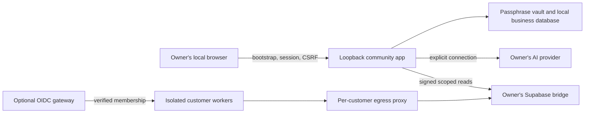

# Architecture

Corestrum keeps four execution paths distinct. Default commands start only the free community workspace.

## Community workspace

`src/corestrum/local/server.ts` binds 127.0.0.1 and creates one private launch token. Its first use creates an HTTP-only SameSite session; mutations also require exact origin and CSRF. A passphrase unlocks the encrypted vault. A random local workspace ID binds the database; there is no payment or hosted activation check in community mode. Explicit legacy configuration is validated and cannot silently downgrade to community mode.

Operations seals briefs, instructions and report contents with purpose-bound AES-GCM. Metadata and activity remain ordinary SQLite. Routines start paused, require an unlocked vault and stop after owner inactivity. API adapters have fixed provider URLs, no redirects and bounded responses. At most 20 model requests are admitted in a rolling day; a coordinated report can use several requests. This is not a dollar budget.

The six roles share the same authority boundary: draft from supplied input, return recommendations, and leave external decisions to the owner. Optional Claude Code runs through a separately prepared profile, verified native executable and restricted tool-free invocation. No private maintainer agent, tool, credentials or controller is imported.

## Optional hosted foundation

`src/production` implements OIDC/PKCE/MFA, opaque server sessions and explicit issuer/subject/customer membership. The gateway chooses a fixed customer socket from trusted configuration. Each worker verifies its customer and role before performing a named operation. `deploy/isolation.ts` renders separate UIDs, data/socket volumes and internal networks; operators must provision independent keys and secret directories and qualify actual isolation.

The Supabase bridge independently enforces installation/project/account scope, short-lived request signatures, body binding, durable replay nonces, restricted database role and forced RLS. It exposes a fixed read projection, not arbitrary SQL or full database administration. See [PRODUCTION-AUTH.md](PRODUCTION-AUTH.md) and [SUPABASE-ONBOARDING.md](SUPABASE-ONBOARDING.md).

## Optional legacy licensing reference

`api/`, `src/corestrum/cloud/` and `cloud/supabase/` retain Clerk, Stripe webhook/reconciliation, complimentary grants and device-bound license examples. They require explicitly supplied operator configuration and dedicated services. The community app neither provisions nor contacts these services. They do not create an entitlement or access grant in a maintainer account.

## Synthetic workflow demo

`src/server.ts`, `src/gateway.ts` and `src/runtime/` implement a separate fictional two-customer workflow, durable approval/idempotency/budget reservations and uncertain-outcome reconciliation. It requires synthetic mode and loopback. Its selectable demo identities are not production authentication and its mocked effects are not live business integrations. Never attach real credentials or expose its listener.

## Distribution

GitHub hosts source with a clean initial history, not internal operating records or a prebuilt runtime. Workflows run on GitHub-hosted runners with read-only permissions; they do not deploy or have access to another application. Runtime/package signing, binary redistribution materials, hosted-provider qualification and organizational SOC 2 assessment remain separate from source tests.
